# 5 Minute Glow Up Salon: Game Design

**Pitch:** Every round has a fun theme: Superhero, Pirate Adventure, Under the Sea, Dinosaur Party, Outer Space, Princess Ball, Fairy Garden, Rock Star, Animal Friends and more. You get **5 minutes** to dress up your own Roblox character to fit it, with hair, makeup, an outfit, costume pieces, a pet and a runway pose. Then everyone walks the runway, everyone votes, and the best look wins.

> **October 2026 change:** this started as a salon where you washed and styled customers. Tori's favorite Roblox games are the dress-up ones where you style yourself and people vote, so the game now dresses **you**. It's not just about beauty: costume pieces, pets and runway effects count as much as makeup. The washing code is kept on the shelf for a possible salon mode.

**Made for:** girls around 6–10. That means few words, big buttons, lots of happy feedback, and nothing that shames a player in front of others.

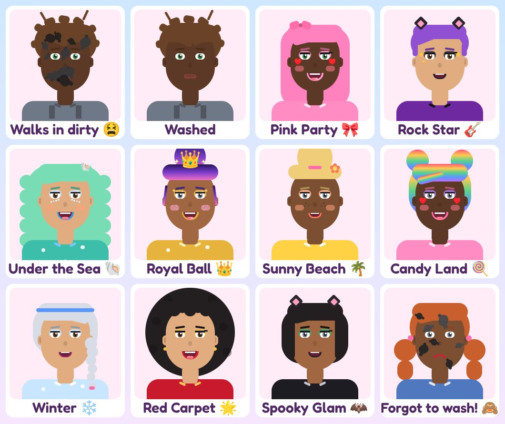

| Washing | Makeup | Nails |
|---|---|---|
| 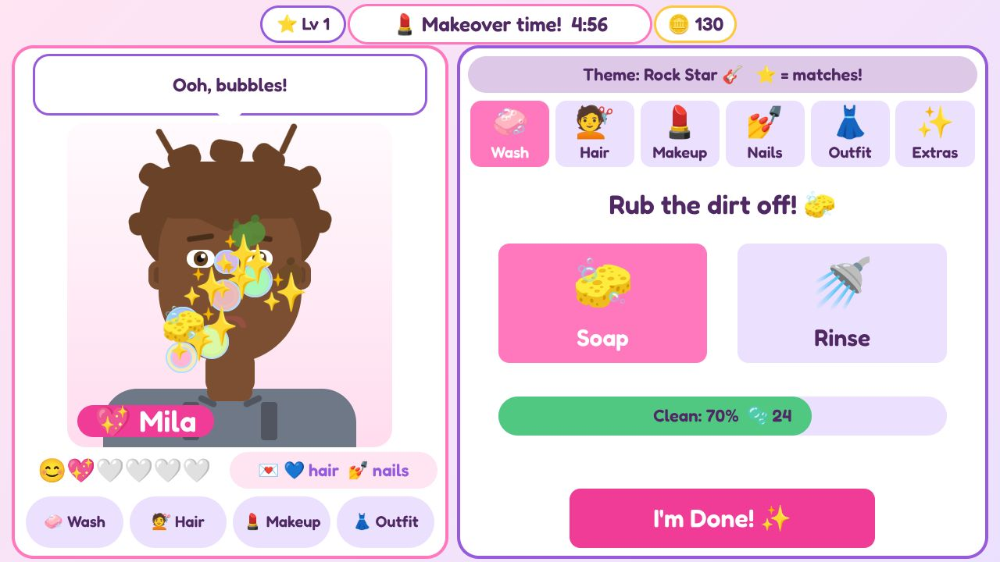 | 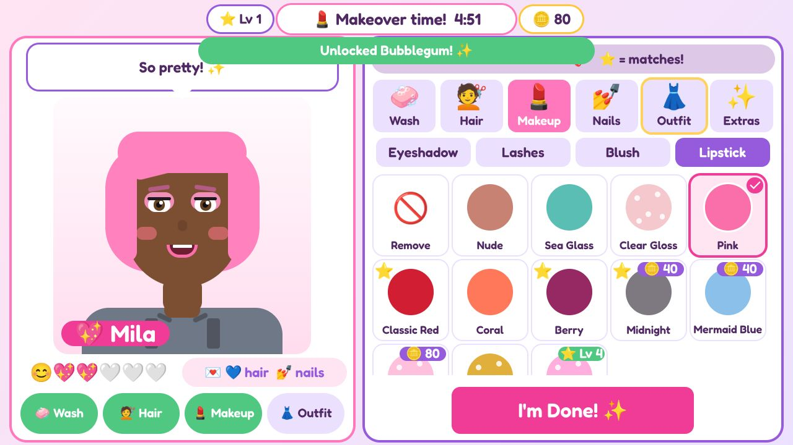 | 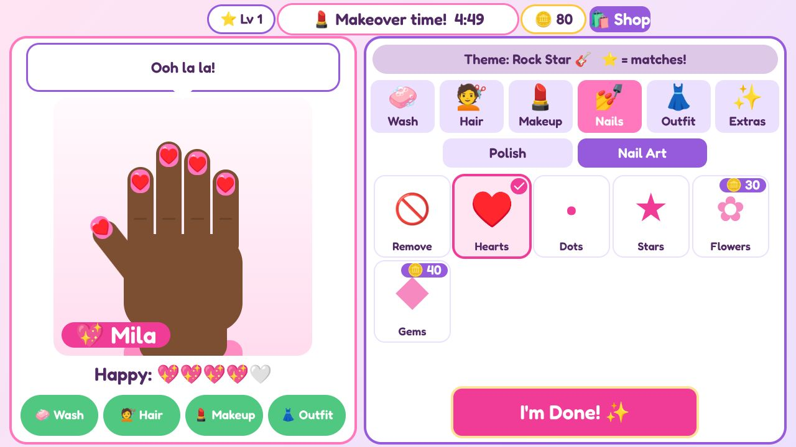 |
| **Outfit colors & patterns** | **Halloween items** | **On a phone** |
| 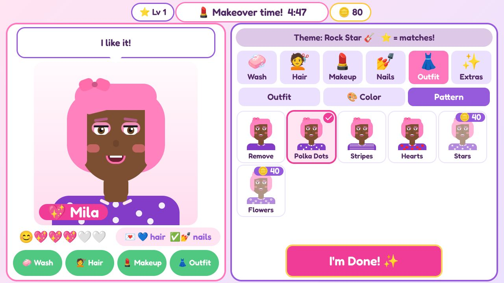 | 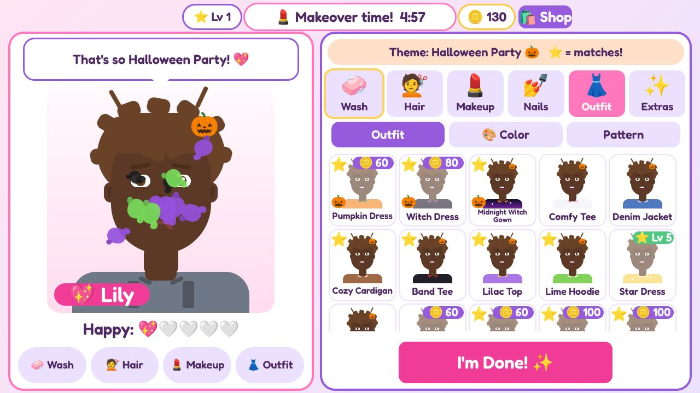 | 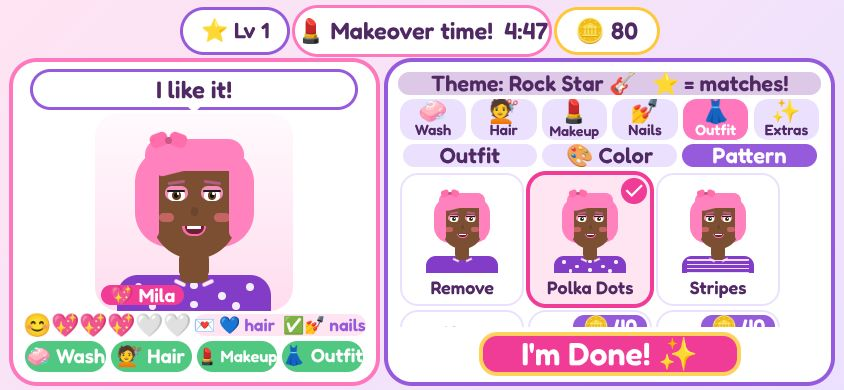 |
| **Runway (camera follows)** | **Halloween runway** | **Christmas runway** |
| 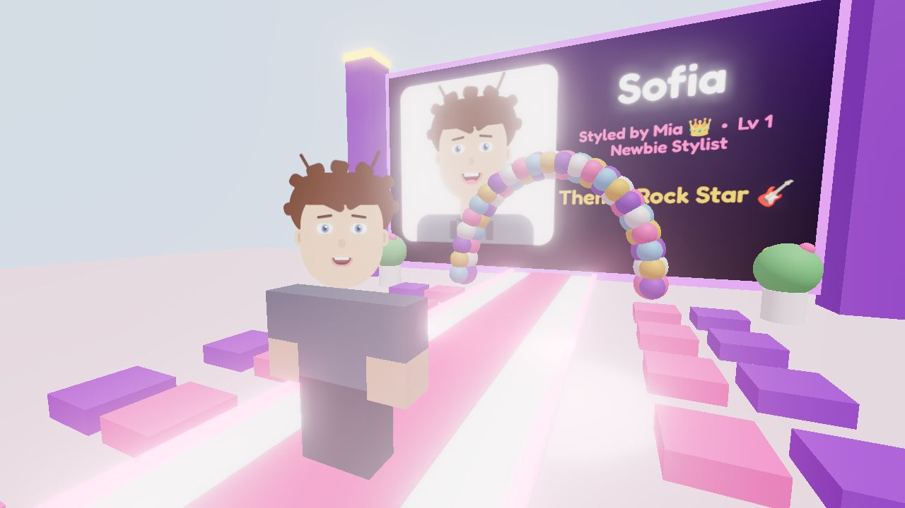 | 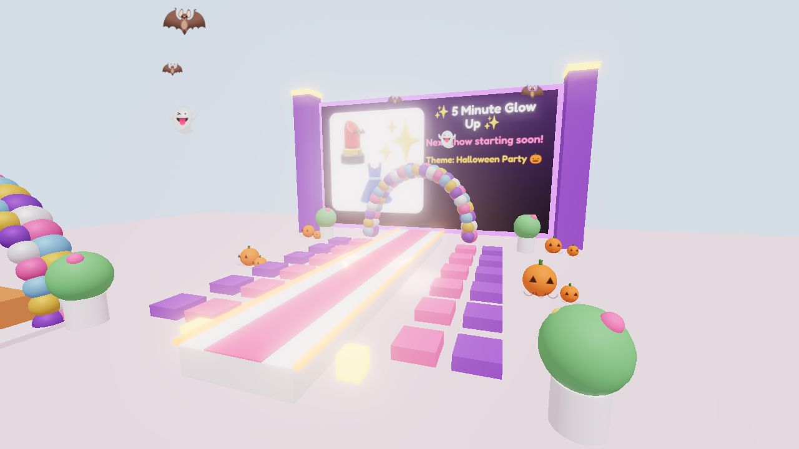 | 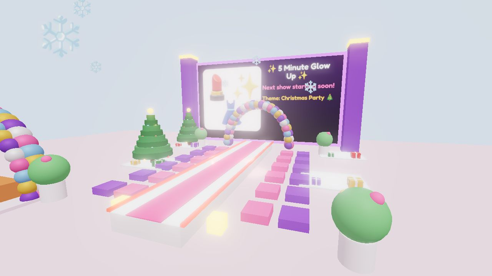 |
| **Podium** | **Results** | **Gift calendar** |
| 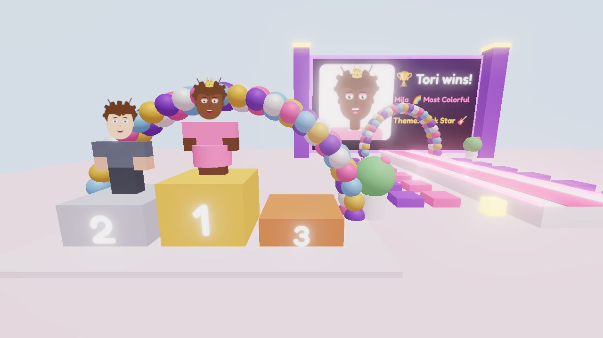 | 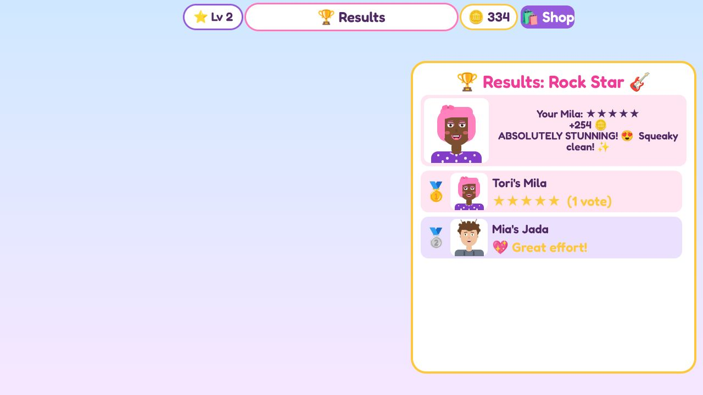 | 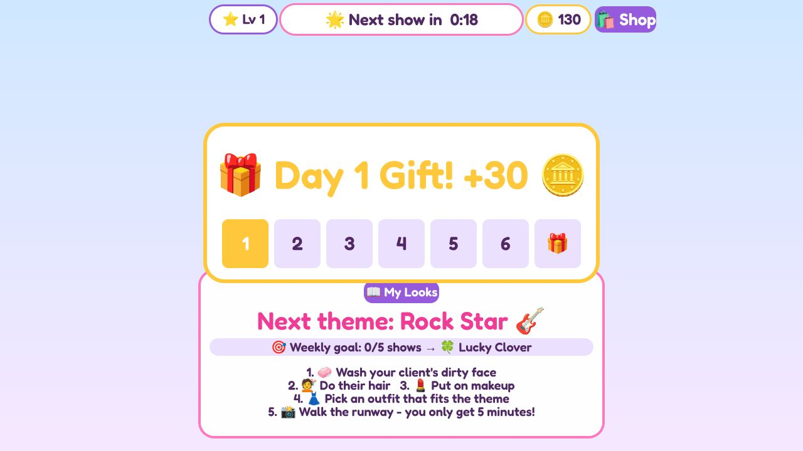 |
| **Look Book** | **Shop** | **Runway paper dolls** |
| 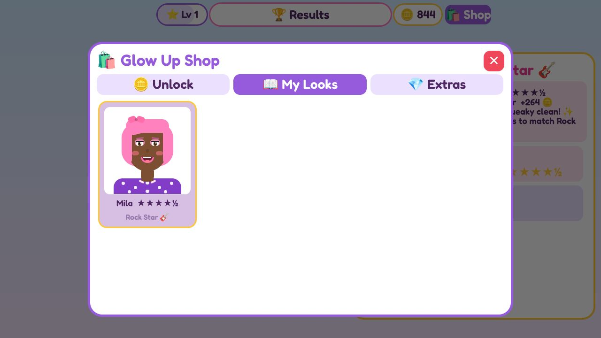 | 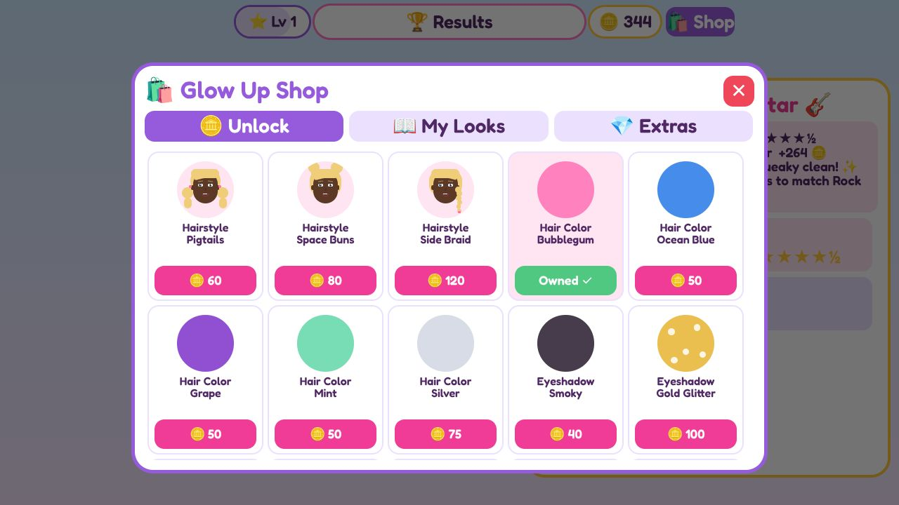 | 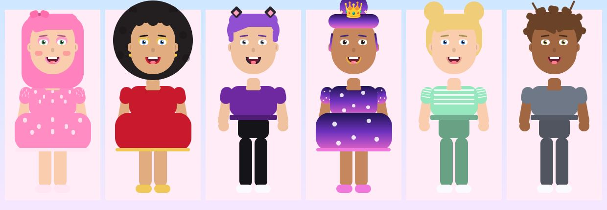 |

*These pictures come from the play-test tool (`tools/playtest`), not Roblox Studio. In Roblox, lighting, fonts and 3D look a little different.*

## Tori's ideas → game features

| Tori said | In the game |
|---|---|
| Makeup game | 💄 Makeup tab: eyeshadow, lashes, blush, lipstick. Plus a 💅 Nails station with polish and nail art |
| Do their hair / you get to do their hair too | 💇 11 hairstyles and 20 hair colors (some only during holidays). Clients show up with **messy** hair you have to fix |
| They come in from the shop dirty, so they have to wash their face | Every client says where they've been ("I fixed cars at the auto shop all day. I'm SO greasy! 😫"). Rub the splats off with 🧽 Soap (✨ pops), then 🚿 Rinse the bubbles. The game switches tools for you |
| Pay to get extra stuff | Coins you earn unlock looks for free. Robux packs add extra looks and fun effects. Nothing paid is needed to win |
| Then you do a fashion show | Clients walk a 3D runway under a balloon arch as a head-to-toe "paper doll" (the same drawing as the makeover, so the dress, colors, pattern, shoes and hair all show). They bounce as they walk and twirl at the end, with a trail of stars. The camera follows them, photographers flash, and everyone taps emoji cheers and hearts |
| You only get 5 minutes to do everything | A "5 minutes! GO! 💨" splash, then one timer for the whole makeover. It turns red and pulses in the last 30 seconds |

## What makes it fun (and easy for little kids)

- **Clients make wishes** ("I wish for 💙 hair and 💅 nails! 💌"). Items that would grant a wish get a 💌 badge. Each wish you grant earns +10 coins and a bonus, and the client cheers.
- **Hands-on hair:** messy hair has to be brushed out first 🖌️ (rub the tangles away) before you pick a style.
- **The client reacts.** Their mouth goes from a frown 😫 (dirty) to a smile, then a big grin 😁. They talk ("That tickles!", "Perfect for Halloween Party! 😍"). The **Happy 💖💖💖🤍🤍** meter fills up as the look gets better.
- **⭐ theme stars** mark items that match the show's theme, so kids don't need to read. Every theme can be matched with free items (the play-test checks this).
- **A glowing "do this next" tab**, plus a checklist that can be tapped.
- **Every card is a preview:** the client's own face wearing that item.
- **🎨 Pick your own outfit color** (20 colors) and a pattern (dots, stripes, hearts, stars, flowers).
- **💅 Nails:** the left panel turns into the client's hand. Each nail sparkles as it's painted.
- **🏅 An award for every look:** Most Rock Star ⭐, Best Hair 💇, Nail Queen 💅, Sparkliest ✨, Wish Granted 💌, and more. No two players get the same award, so everyone wins something.
- **You walk out too:** at the end of the runway your own avatar steps out next to your client.
- **Kind by design:**
  - Votes are 💖 / 💖💖 / 💖💖💖, so nobody can give 1 star.
  - Everyone's client is shown washed and smiling on the big screen and podium. The judges' tips are private.
  - Results list everyone with their award. Stars show only when they're 4 or more (you always see your own), and nobody gets a last-place number.
  - Judges' tips are sent only to the player they're for.
- **Safe social play:** emoji cheers and heart votes only. There's no typing.
- **Something to do while waiting:** "🌸 Spritz perfume!" makes the client giggle.

## Reasons to come back

- **🎁 7-day gift calendar:** coins on days 1–6 and a special accessory on day 7 (Golden Bow, Rainbow Headband, Pearl Earrings). Missing a day **pauses** it and never resets it.
- **🎯 Weekly goal:** play 5 shows in a week (idle rounds don't count) to win a hair clip (🍀 🦄 🌈 🍓). Days and weeks change at midnight US Eastern time, and weeks start on Monday.
- **⭐ Stylist levels:** each level needs a few more stars than the last (6, 14, 24, 36…). Many levels unlock items:

  | Level | Item |
  |---|---|
  | 2 | Butterfly Clip |
  | 3 | Cotton Candy hair |
  | 4 | Bubblegum Gloss |
  | 6 | Star Dress |
  | 8 | Rainbow Shimmer |
  | 10 | Star Halo |
  | 12 | Diamond Tiara |
  | 15 | Unicorn hair |
  | 20 | Legendary Gown |
 Titles go from Newbie Stylist to Legendary Stylist.
- **💞 Regular clients:** clients you've styled come back ("Hi again! It's me, Amara!"). Their 3rd, 5th and 10th visits make them best friends and give bonus coins.
- **📖 Look Book:** your last 24 finished looks are saved, like a photo album.
- **🎃 🍂 🎄 Holiday events** (turn on by date):

  | Event | Dates |
  |---|---|
  | Halloween | Oct 10 – Nov 2 |
  | Harvest Festival | Nov 3 – 30 |
  | Christmas | Dec 1 – 31 |

  Each event brings:
  - a holiday fashion-show theme (about half the rounds)
  - about 12 limited items: some free, some for coins, and VIP gowns
  - holiday client stories (pumpkin goo, pie flour, gingerbread)
  - decorations and lighting: pumpkins, bats and ghosts; autumn trees and hay bales; Christmas trees, presents and falling snow

  Items a player unlocked or used during an event are theirs to keep.

## Round loop (everyone in the server plays together)

1. **Intermission (20s) on the rooftop:** next theme, event banner, weekly goal and a how-to card. 12 glowing ⭐ stars bob around the rooftop: run into one for +2 coins. Players can open the Shop or Look Book.
2. **Dressing Hall (5:00):** everyone walks around in their own avatar. Six stations: 💇 Hair Chair, 💄 Makeup Vanity, 👗 Wardrobe, 🦸 Costume Closet (hats, wings and capes, masks, tails, shoulder buddies), 🐶 Pet Park, 💃 Pose Stage (pose and effect). Step on a glowing pad and its menu opens while the camera frames you; the look goes on your real character, so everyone sees everyone getting ready. A guide on the left shows what's done (the next step is solid pink with 👉, and a bouncing "Walk here!" marker floats over it) and walks you there. **I'm Done!** stays quiet until three stations are done and asks once before ending early (always asks on touch screens).
   - **Judge's Wishes:** each round the judge wishes for two theme things ("🎩 a pirate hat or clip", "💋 red lips"), always doable with free items. Shown along the bottom; +15 coins each.
   - **Real Clothes:** layered dresses, suits and jackets from the avatar shop that wrap to any body (free starter closet, coin dream outfits, pack outfits).
   - **Hurry-up:** once half the real players are done, everyone else gets 30 seconds, so nobody waits five minutes.
   - **Body positivity:** you play in your own skin and body; there is no skin picker, and the game only adds things. A classic head carries the drawn makeup face during the round, and your normal look comes back after the show.
3. **Fashion Show (~9s per look):** you walk the runway in your own avatar with your pet trotting alongside and your effect around you, then strike your pose. Everyone else sits in the audience; they vote with hearts (+2 coins for voting), and tapping a cheer makes their avatar cheer too. Cheers fill a **cheer meter**; filling it sets off fireworks over the runway and gives the walker +5 coins (your own cheers don't count; on your own walk you get pose buttons instead).
   - **Between rounds:** a dance floor under a disco ball (step on it and you dance), string lights and balloons, a photo booth (3-2-1, flash, your pose, a polaroid with your name and the theme), and your pet follows you around the hall.
   - **Style Bots (solo play):** when there are fewer than 3 players, 🤖 bots fill in. They dance between rounds, walk to the stations and dress for the theme, walk the runway, cheer, and give every real look 4-5 hearts. They always place below the real kids and never earn coins. One lobby switch ("🤖 Robot friends") turns them off for the whole server.
   - **Runway walk:** everyone wears Roblox's Catwalk Glam walk during the round, twirls at the end of the runway, then strikes their pose.
4. **Results (15s):** a drumroll, fireworks, and the top 3 stand on the podium. Each player gets a private card with their **ribbon** (🥉 Bronze at 3 stars, 🥈 Silver at 4, 🥇 Gold for 5 stars with every wish), stars, coins and judge tips. When you play alone the ribbon is the goal.

## Scoring (out of 5 stars)

| Part | Points |
|---|---|
| The show: costume pieces, a pet, a pose, an effect (4 of them = full points) | 1 |
| Hair styled | 0.5 |
| Makeup applied (4 kinds) | 0.75 |
| Outfit chosen | 0.5 |
| **Theme:** how many parts match (hair, makeup, outfit or 🎨 color, hat, costume pieces, pet, pose, effect, face art). 4 matches = full points | 2.25 |
| Bonus: face art, hat | up to 0.2 |

Awards include 🎭 Best Costume, 🐶 Best Buddy and 🔥 Showstopper. The final score is the average of the judges and the players' heart votes, or the judges alone if nobody voted.

## Coins

- Start with 100. The gift calendar gives 30–80 coins a day.
- Every show: 20 + 10 per star, +15 per judge's wish.
- Placing (2+ real players): 1st +50, 2nd +30, 3rd +15.
- +2 for each look you vote on, +5 when the crowd goes wild for your walk, +2 per lobby star.
- +20% when a Roblox friend is in the server.
- Big goals: 13 Real Clothes dream outfits cost 350 to 1,000 coins (about 10+ hours of play for everything).

About 170 items: 72 everyday items are free, 58 cost 30–150 coins, 21 come in Robux packs, and 35 are holiday items that come and go.

## Monetization (kid-friendly, follows Roblox rules)

- No loot boxes or random paid items.
- Every purchase shows exactly what you get.
- Nothing paid skips a part of the makeover. 2x Coins and the coin pack only make unlocking faster.
- Every theme can be matched with free items.
- Holiday items never use countdowns or "buy before it's gone" messages.

| Type | Item | What it does | Suggested price |
|---|---|---|---|
| Game Pass | 👑 VIP Glam Kit | Real Starlight Royal Gown and Rainbow Sequin Dress, Rainbow & Galaxy hair, Royal Updo, Mermaid Waves, Rainbow Wings, Galaxy Glitter, Starry Lashes, Golden Glam lips, Rhinestones, Royal Crown, Golden Gala & Galaxy gowns, Rainbow Trail | 199 R$ |
| Game Pass | 👸 Princess Pack | Real Pastel Summer and Enchanted Rainbow gowns, Ice Ball Gown, Rose Gown, Princess Curls, Rose Gold hair, Princess Tiara, Pink Gems, Unicorn pet | 149 R$ |
| Game Pass | 👗 Fashion Week Pack | 6 real outfits: Pink Ribbon, Pink Ruffle, Rainbow Heart, Snow Crystal, Pastel Dream, Designer Puffer | 99 R$ |
| Game Pass | 🐢 Pet Palace | Winged Bunny, Glitter Kitty, Baby Pegasus, Bubble Turtle | 149 R$ |
| Game Pass | 🪙 2x Coins | Double coins every show | 149 R$ |
| Game Pass | 🌟 Runway Star | Confetti cannons + sparkles when you walk | 99 R$ |
| Dev Product | 💰 Coins | 500 / 1,500 / 4,000 coins | 49 / 99 / 199 R$ |

- **Never a Robux prompt during a round.** Tapping a pack item mid-round says "ask a grown-up in the Shop after the show". Pack prompts only open from the lobby Shop.
- **No "who paid" badges** on the vote card, so votes stay about the look.

New packs are easy to add: give items `pass = "PackName"` in `Catalog` and add the pass ID to `Config.GamePasses`. Good next packs are Mermaid Lagoon, Winter Princess and Halloween Costumes. Private servers (free or cheap) are great for sleepovers.

## Ideas for version 2

- Co-op "Best Friend Mode": two stylists on one client
- Your own salon to decorate with coins
- Shoes slot (layered shoes) and two hats at once for layering
- Pet friendship levels (name tag, bow, a runway trick)
- Ribbon Wall: a lobby wall with your best ribbon for each theme
- Voice clips for the client ("Ewww!", "I LOVE it!") for kids who can't read yet
- Photo mode: save the booth polaroid to a Look Book page
- Client of the Day requests ("Make me look like a mermaid!")
