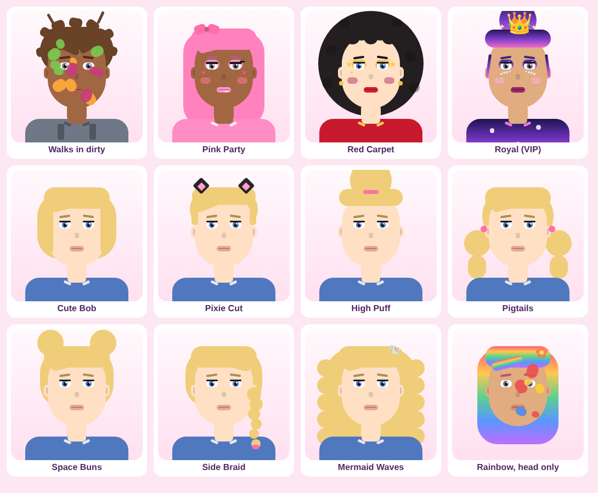

# 5 Minute Glow Up Salon: Game Design

**Pitch:** Customers walk into your salon straight from their jobs at the shop, covered in grease, mud, paint and frosting. You get **5 minutes** to wash their face, do their hair and makeup, and dress them for the fashion show. Then they walk the runway, everyone votes, and the best stylist wins.

## Tori's ideas → game features

| Tori said | In the game |
|---|---|
| Makeup game | Makeup tab: 9 eyeshadows, 3 lash styles, 4 blushes and 9 lipsticks |
| Do their hair / you get to do their hair too | Hair tab: 10 hairstyles + 11 hair colors. Clients show up with **messy** hair you have to fix |
| They come in from the shop dirty, so they have to wash their face | Every client has a story ("just finished a shift at the auto shop…"). Their face has grease or mud spots. Pick **Soap**, rub the dirt off, then pick **Rinse** to wash away the bubbles |
| Pay to get extra stuff | Coins you earn unlock new looks. Robux buys VIP items, 2x coins, runway effects and Super Soap |
| Then you do a fashion show | Each client walks a 3D runway with your face design on the big screen. Other players vote 1–5 stars |
| You only get 5 minutes to do everything | One 5-minute timer for the whole makeover. It turns red and pulses in the last 30 seconds |

**Things we added so it plays well:**
- **Themes** (Pink Party, Rock Star, Under the Sea, Royal Ball…) give each round a goal, so you have to think about what to pick, not just pick at random.
- **AI judges** score every look, so the game works with just 1 player. With more players, judges and player votes count half each.
- **Outfits and extras** (bows, crowns, face stickers) so the fashion show has something to show off.
- **Judge comments** explain what to fix ("Rinse off the soap bubbles!") so kids get better each round.
- **"I'm Done!" button.** If every stylist finishes early, the show starts early.

## Round loop (everyone in the server plays together)

1. **Intermission (20s):** the next theme is shown, with a how-to-play card. Players can browse the shop.
2. **Makeover (5:00):** each player gets their own dirty client.
   - 🧼 **Wash:** rub dirt with Soap, then Rinse the bubbles
   - 💇 **Hair:** style + color
   - 💄 **Makeup:** eyeshadow, lashes, blush, lipstick
   - 👗 **Outfit:** pick something that fits the theme
   - ✨ **Extras:** face art + accessory
   - Checklist turns green as each step is done.
3. **Fashion Show (~9s per look):** the client walks the runway and twirls. Their face is on the big screen. Everyone else taps 1–5 stars (+2 coins for voting).
4. **Results (15s):** top 3 clients stand on the podium. Each player sees their stars, judge comments and coins earned.

## Scoring (out of 5 stars)

| Part | Points |
|---|---|
| Face washed (all dirt gone) | 1 |
| Hair styled (not messy) | 0.75 |
| Hair color matches theme | 0.5 |
| Makeup applied (4 kinds) | 1 |
| Makeup colors match theme | 0.75 |
| Outfit chosen / matches theme | 0.5 / 0.5 |
| Bonus: face art, accessory, accessory matches | up to 0.75 |

Forgot to rinse the bubbles? −0.2. Final = average of judges and player votes (judges only if no one voted).

## Coins (free to earn)

- Start with 100 coins
- Every show: 20 + 10 per star, +10 for a spotless wash
- Placing (2+ players): 1st +50, 2nd +30, 3rd +15
- Voting: +2 per look you rate

About half the items are free from the start. The rest cost 30–150 coins, so a kid who plays a few rounds can unlock them without paying.

## Monetization (kid-friendly, follows Roblox rules)

No loot boxes or random paid items. Every purchase shows exactly what you get.

| Type | Item | What it does | Suggested price |
|---|---|---|---|
| Game Pass | 👑 VIP Glam Kit | Rainbow & Galaxy hair, Royal Updo, Mermaid Waves, Galaxy Glitter, Starry Lashes, Golden Glam lips, Rhinestones, Royal Crown, Golden Gala & Galaxy gowns, VIP badge on the runway | 199 R$ |
| Game Pass | 🪙 2x Coins | Double coins every show | 149 R$ |
| Game Pass | 🌟 Runway Star | Confetti cannons + sparkles when your client walks | 99 R$ |
| Dev Product | 🧼 Super Soap | Instantly cleans the face (saves time on the clock) | 15 R$ |
| Dev Product | 💰 500 Coins | Coins | 49 R$ |
| Dev Product | 💎 2000 Coins | Coins | 149 R$ |

Super Soaps are saved if you aren't in a makeover when you buy one, so a purchase is never lost.

## Ideas for version 2

- Daily login reward and a streak calendar
- More client stories and dirt types (glitter slime, ketchup, sunburn → aloe)
- Nail painting station
- Private servers for friends / sleepovers
- Seasonal themes (Halloween, Valentine's) with limited-time items
- Leaderboard of most wins
- Real 3D hair accessories on the runway models
- Sounds and music (needs uploaded audio)
