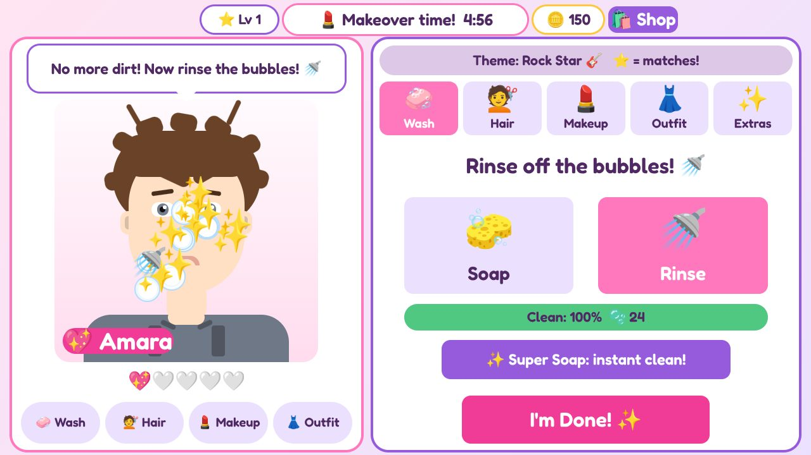
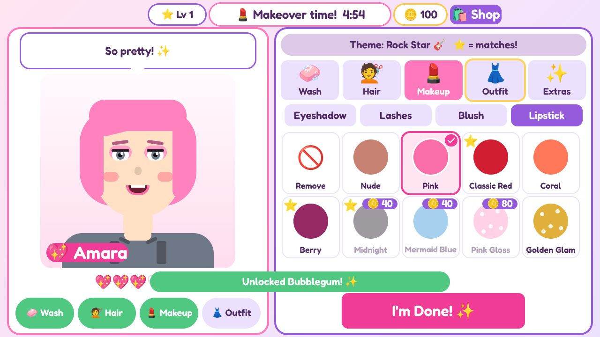
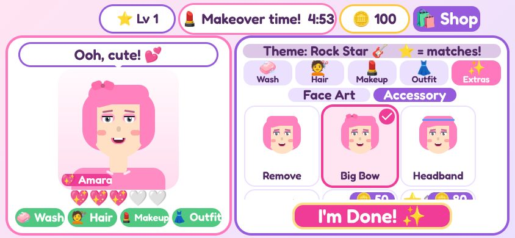
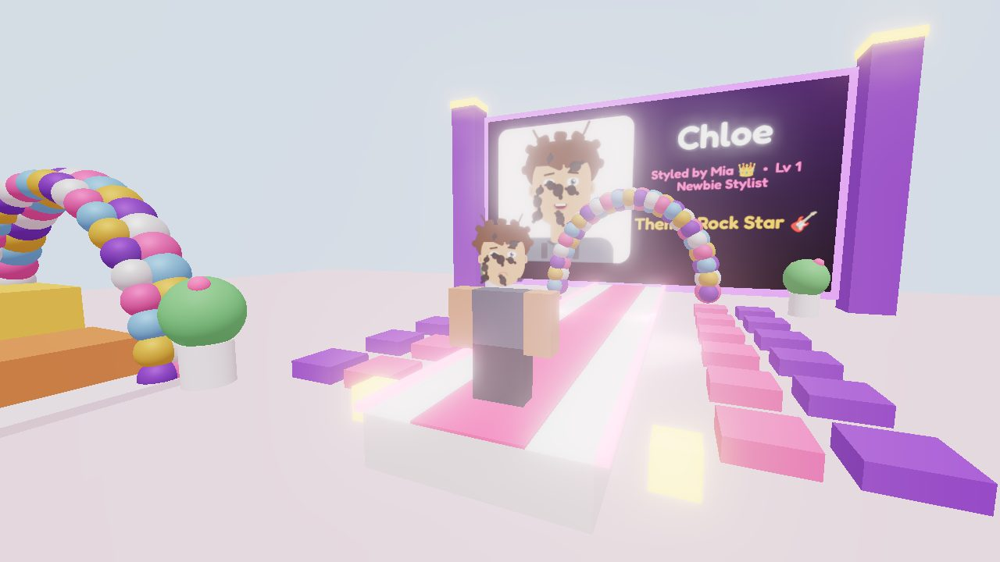
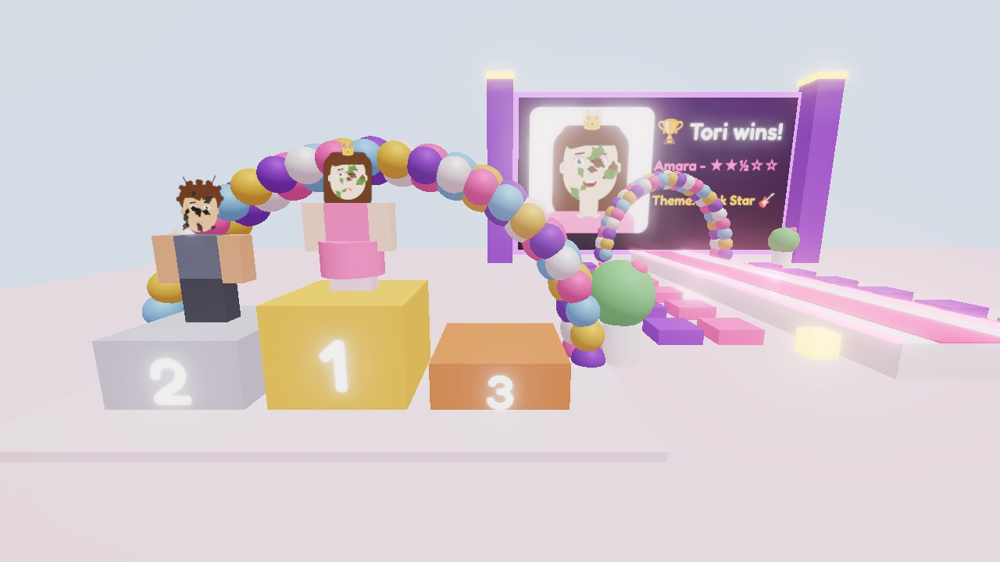
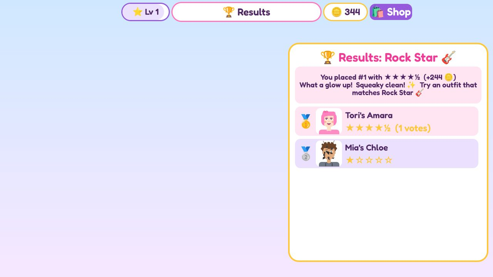

# 5 Minute Glow Up Salon: Game Design

**Pitch:** Customers walk into your salon straight from their jobs at the shop, covered in grease, mud, paint and frosting. You get **5 minutes** to wash their face, do their hair and makeup, and dress them for the fashion show. Then they walk the runway, everyone cheers and votes, and the best stylist wins.

**Made for:** girls around 6–10. That means few words, big buttons, lots of feedback, and nothing scary or competitive in a mean way.

| Washing | Picking makeup | On a phone |
|---|---|---|
|  |  |  |

| Runway (camera follows the client) | Winners' podium | Results |
|---|---|---|
|  |  |  |

*These pictures come from the play-test tool (`tools/playtest`), not Roblox Studio. In Roblox, lighting, fonts and 3D look a little different.*

## Tori's ideas → game features

| Tori said | In the game |
|---|---|
| Makeup game | Makeup tab: 9 eyeshadows, 3 lash styles, 4 blushes and 9 lipsticks |
| Do their hair / you get to do their hair too | Hair tab: 10 hairstyles + 11 hair colors. Clients show up with **messy** hair you have to fix |
| They come in from the shop dirty, so they have to wash their face | Every client tells you where they've been ("I fixed cars at the auto shop all day. I'm SO greasy! 😫"). Pick 🧽 **Soap** and rub off the splats. ✨ pops when a splat comes off. Then 🚿 **Rinse** the bubbles (the game switches tools for you) |
| Pay to get extra stuff | Coins you earn unlock new looks. Robux buys VIP items, 2x coins, runway effects and Super Soap |
| Then you do a fashion show | Each client walks a 3D runway under a balloon arch, with your design on the big screen. The camera follows them, photographers flash, and everyone taps emoji cheers and votes 1–5 stars |
| You only get 5 minutes to do everything | A "5 minutes! GO! 💨" splash, then one timer for the whole makeover. It turns red and pulses in the last 30 seconds |

## What makes it fun (and easy for little kids)

- **The client reacts.** Their mouth changes from a frown 😫 (dirty) to a smile, then a big grin 😁. They talk in a speech bubble: "That tickles!", "Perfect for Pink Party! 😍", "This is my BEST look EVER! 💖" (with confetti).
- **Happy hearts 💖💖💖🤍🤍** under the face fill up as the look gets better. It's the same score the judges use, so kids learn what works.
- **⭐ theme stars** on items that match the show's theme. No reading needed.
- **Glowing "do this next" tab**, plus a checklist (🧼 💇 💄 👗) that turns green and can be tapped to jump to that step.
- **Every look is a preview.** Item cards show the client's own face wearing that item.
- **Friendly results.** Everyone gets a pop-up ("✨ Great job!", "🏆 You WON!"), coins and tips from the judges, never a "you lost".
- **Safe social play.** Players cheer with fixed emoji (😍👏🔥✨💖) and star votes. There's no typing.
- **Coming back pays off.** A 🎁 daily gift (bigger for days in a row) and stylist levels (Newbie Stylist → Rising Star → Pro Stylist → Glam Queen → Superstar → Legendary), with a confetti pop-up when you level up.

## Round loop (everyone in the server plays together)

1. **Intermission (20s):** the next theme and a 5-step how-to card. Players can browse the shop.
2. **Makeover (5:00):** each player gets their own dirty client.
   - 🧼 **Wash:** rub dirt with Soap, then Rinse the bubbles
   - 💇 **Hair:** style + color
   - 💄 **Makeup:** eyeshadow, lashes, blush, lipstick
   - 👗 **Outfit:** pick something that fits the theme (dresses get a skirt on the runway)
   - ✨ **Extras:** face art + accessory
   - If every stylist taps **I'm Done!**, the show starts early.
3. **Fashion Show (~9s per look):** the client walks the runway and twirls. Everyone else gives 1–5 stars (+2 coins for voting), and anyone can tap emoji cheers that float up on every screen.
4. **Results (15s):** the top 3 stand on the podium. Each player gets a pop-up with their stars, judge tips and coins.

## Scoring (out of 5 stars)

| Part | Points |
|---|---|
| Face washed (all dirt gone) | 1 |
| Hair styled (not messy) | 0.75 |
| Hair color matches theme | 0.5 |
| Makeup applied (4 kinds) | 1 |
| Makeup colors match theme | 0.75 |
| Outfit chosen / matches theme | 0.5 / 0.5 |
| Bonus: face art, accessory, accessory matches | up to 0.75 |

Forgot to rinse the bubbles? −0.2. Final = average of judges and player votes (judges only if no one voted).

## Coins & levels (free to earn)

- Start with 100 coins, plus a daily gift of 50 coins (+10 for each day in a row, up to +50)
- Every show: 20 + 10 per star, +10 for a spotless wash
- Placing (2+ players): 1st +50, 2nd +30, 3rd +15
- Voting: +2 per look you rate
- Every 5 stars earned = 1 stylist level

About half the items are free from the start. The rest cost 30–150 coins, so a kid who plays a few rounds can unlock them without paying.

## Monetization (kid-friendly, follows Roblox rules)

No loot boxes or random paid items. Every purchase shows exactly what you get, and nothing paid is needed to win.

| Type | Item | What it does | Suggested price |
|---|---|---|---|
| Game Pass | 👑 VIP Glam Kit | Rainbow & Galaxy hair, Royal Updo, Mermaid Waves, Galaxy Glitter, Starry Lashes, Golden Glam lips, Rhinestones, Royal Crown, Golden Gala & Galaxy gowns, VIP badge on the runway | 199 R$ |
| Game Pass | 🪙 2x Coins | Double coins every show | 149 R$ |
| Game Pass | 🌟 Runway Star | Confetti cannons + sparkles when your client walks | 99 R$ |
| Dev Product | 🧼 Super Soap | Instantly cleans the face (saves time on the clock) | 15 R$ |
| Dev Product | 💰 500 Coins | Coins | 49 R$ |
| Dev Product | 💎 2000 Coins | Coins | 149 R$ |

Super Soaps are saved if you aren't in a makeover when you buy one, so a purchase is never lost.

## Ideas for version 2

- Nail painting station
- More client stories and dirt types (glitter slime, ketchup, sunburn → aloe)
- Seasonal themes (Halloween, Valentine's) with limited-time items
- Private servers for friends / sleepovers
- Leaderboard of most wins
- Real 3D hair accessories on the runway models
- Photo mode: save a picture of your best look
